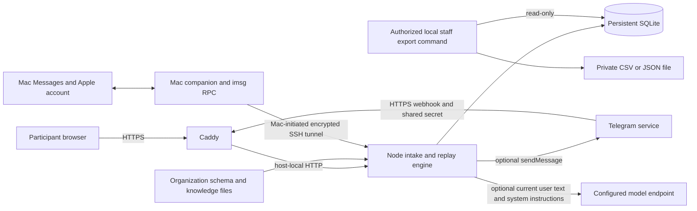

# Architecture and data boundaries

One installation serves one organization. The cloud host runs a single Node 24 process backed by local SQLite; it can operate without a model service or a Mac. The organization supplies the schema and local knowledge Markdown files. No external CRM or future adapter listed in the README is implemented merely by being named there.

The SSH tunnel must carry the companion's plaintext pairing/RPC connection; it is not built into the application. See [deployment](deployment.md). The Mac holds Messages access and Apple account credentials. The cloud never needs those Apple credentials, but it receives the text and channel identity used by the intake channel.

## Deterministic intake and optional model handoff

`src/conversation.ts`, `values.ts`, `recordStore.ts` and `linkCodes.ts` decide the field, validation, agreement, summary, final confirmation and record mutation. A saved revision is tied to the exact confirmed values. Matching names, emails and phone numbers do not link chats; an explicit one-time link code does. SQLite transactions checkpoint interpretation together with intake changes before awaiting optional model output.

Without `MODEL_API_KEY`, `LocalModel` returns the deterministic safe reply. With a key, the OpenAI-compatible client sends a `POST` to `MODEL_BASE_URL/chat/completions` with `MODEL_NAME`, system instructions and the **current user message**. It sends neither the entire chat history nor the database. The current message can itself contain personal intake details or a link code. Review that provider's retention, location, access and contractual terms, disclose the boundary to participants, and use an HTTPS endpoint before enabling it. Optional external models can incur provider charges.

The reply selector currently accepts model text only when it equals the deterministic safe reply; all different output falls back to that safe reply. The model does not decide consent, mutate records, retrieve arbitrary URLs, or independently approve enrollment. Model failures fall back to deterministic wording. Enabling a model still transfers the current message to the configured endpoint even though different wording is rejected.

Organization answers use locally indexed passages in SQLite FTS. Search misses are not facts, video titles are not video transcripts, and scripture handling supplies references rather than generated verse text. These are bounded application rules, not an assurance about the accuracy of operator-supplied knowledge.

## Persistence and trust

| Surface | Stored or handled data | Operator boundary |
| --- | --- | --- |
| `session_groups` and `sessions` | Draft values, confirmation hashes, saved-record pointer, channel identities and shared-group linkage | Linked sessions can share a draft; there is no tenant boundary inside this database. |
| `records` | Every confirmed saved revision with values, timestamp and confirmation hash | A save is intake persistence, not approval or external registration. |
| `incoming_requests` | Original message, channel key, request ID, recipient and serialized prepared/result data | Sensitive replay snapshots can include values even after the draft changed. No timestamp or group foreign key supports a universal age/person purge. |
| `telegram_updates` | Telegram chat ID, update ID, reply and delivery/recovery state | Telegram has its own external chat history and retention. |
| `link_codes` / `imsg_pair_codes` | Channel-link and companion-pairing state | Expiry prevents redemption; it does not automatically erase stored rows or journal entries. |
| Knowledge tables / FTS | Local source URLs, titles and passages | Treat organization files as approved input; no general web crawler exists. |
| SQLite WAL, backups, CSV/JSON exports, logs and Mac Messages | Additional copies or delivery traces | Database deletion alone does not erase these copies or provider-held data. |

The browser uses its session identifier as the capability to resume an intake; there is no participant password login or staff dashboard. Protect browser storage, public endpoint exposure and the host accordingly. The Telegram webhook requires its configured shared secret. The pair code authenticates initial companion access but provides no transport encryption. Local staff export relies on filesystem permissions and creates new `0600` files; it has no public HTTP route. Read [record export](record-export.md) and [operations](operations.md) for handling requirements.

Replay checkpoints prevent applying the same identified intake action twice. They do not guarantee exactly-once external delivery: a lost acknowledgment after a successful provider send can cause a duplicate reply. Process health alone does not establish channel health, successful backups, or real-device acceptance.
